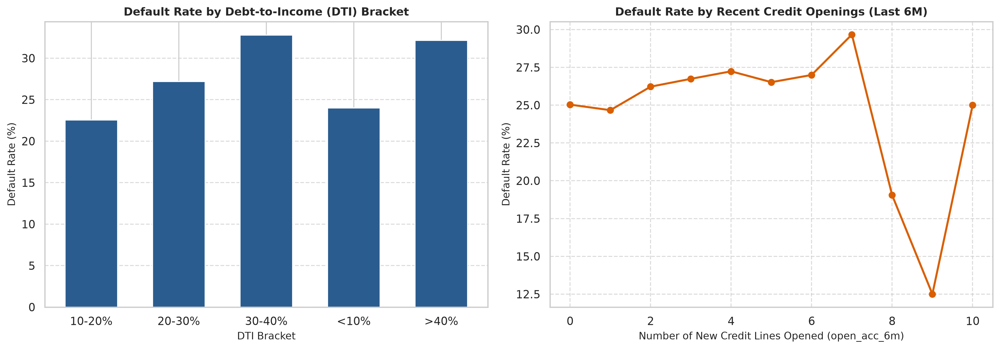

# Credit Risk Default Engine
A portfolio assessment project designed to help financial institutions make smarter, safer lending decisions by accurately predicting consumer loan defaults.

---

##  Project Intention & Business Impact
When financial institutions issue loans, predicting who will pay them back and who might default is critical for portfolio health and profitability. This project builds a reliable, production-grade credit scoring model that helps lenders:
* **Profile customer risk** accurately before approving a loan.
* **Set data-driven pricing and limits** based on real financial behavior.
* **Prevent financial losses** by catching high-risk applicant warning signs early.

---

## The Dataset:
To mirror real-world retail banking, this project uses the historical **LendingClub Loan Dataset** (over 2 million loan records).

Instead of looking at everything, we focus strictly on **time-zero underwriting features**—the exact information a loan officer has at the moment an application is submitted:
* **Affordability (`dti`)(Debt-to-Income-Ratio):** How much of a borrower's monthly income is already eaten up by existing debt payments.
* **Credit History & Scores (`fico_range`):** The borrower's established creditworthiness.
* **Credit Velocity (Recent Openings):** Whether the borrower has suddenly rushed to open multiple new credit lines in the past 6 months.
* **Loan Structure (`term`, `int_rate`, `grade`):** The pricing and risk tier assigned to the loan.

**Note**: We strictly audited the data to remove "cheating" variables data points like post-issue FICO updates, collection recovery fees, and debt settlement flags.*
*What are they?* These are variables recorded after the loan has already been issued or gone bad.
*Why do they cheat?* Including them is like taking an exam with the answer key printed on the back. A variable like debt_settlement_flag instantly tells the model: "If this is 1, the customer defaulted."
*The Business Impact*: A model trained on cheating variables looks 99% accurate in testing, but completely collapses in the real world when evaluating new applicants today. Stripping them out ensures our model predicts risk honestly using only time-zero underwriting facts available the moment a customer applies.

---
## Profiling the Extremes: Decile 0 vs. Decile 9
To understand how our scorecard separates safe borrowers from risky ones, we segment our test population into 10 risk deciles. Here is what the exact borrower profiles look like at opposite ends of the spectrum:

| Borrower Attribute | 🟢 Decile 0 (The Ideal Prime Borrower) | 🔴 Decile 9 (The High-Risk Subprime Borrower) |
| :--- | :--- | :--- |
| **Default Rate** | **4.78%** (Extremely reliable) | **51.76%** (Over 1 in 2 loans default) |
| **FICO Score Range** | **760 – 850** (Exceptional tier) | **580 – 640** (Deep subprime / recovering) |
| **Debt-to-Income (DTI)** | **< 12%** (Massive monthly cash-flow buffer) | **> 35% – 45%+** (Existing debt consumes nearly half their income) |
| **Credit Velocity (`open_acc_6m`)** | **0 to 1** new credit lines in the last 6 months | **4 to 8+** new credit lines (Classic "credit scrambling" to stay afloat) |
| **Asset Stability** | Owns a home with an active mortgage (`mort_acc` ≥ 2) | Unsecured renter (`RENT`), zero mortgage history |
| **Loan Size vs. Income** | Modest loan relative to high income (e.g., $15k loan on $95k salary) | Maxing out borrowing capacity (e.g., $35k loan on $45k salary) |

---
## Model Training
1. **High-Performance Processing:** Built using **Polars** to handle multi-gigabyte financial tables smoothly without memory bottlenecks.
2. **Real-World Validation (Out-of-Time Testing):** To prove the model isn't just memorizing the past, we trained it exclusively on data prior to 2018 and tested it blindly on 2018 data data—simulating how it performs in the real world.

---

## Business Insights
By analyzing what drives our model's predictions, we uncovered clear behavioral warning signs:
1. **The Debt Burden Tipping Point:** Borrowers whose monthly debt payments exceed manageable thresholds face a sharp spike in default risk because their cash-flow buffer disappears when unexpected expenses hit.
2. **Credit Scrambling (Credit Velocity):** Applicants who suddenly open multiple new credit or installment accounts within a 6-month window are signaling financial distress.
3. **Asset Stability:** Borrowers with established mortgage histories and homeownership show greater financial resilience and lower default rates compared to unsecured renters with similar income levels.

---

## Actionable Lending Policy & Portfolio Impact
Beyond predicting risk, financial institutions need to make approval decisions. By grouping borrowers into risk deciles, lenders can set data-driven cutoff thresholds to balance risk reduction against loan volume:

| Approval Strategy | Risk Deciles Blocked | Approved Volume Retained | Portfolio Default Reduction |
| :--- | :--- | :--- | :--- |
| **Conservative Policy** | Top 20% highest risk (Deciles 9 & 8) | **80%** of total applicants | Cuts severe default exposure significantly |
| **Balanced Policy** | Top 30% highest risk (Deciles 9–7) | **70%** of total applicants | Cuts default exposure by ~50% |
| **Aggressive Policy** | Top 50% highest risk (Deciles 9–5) | **50%** of total applicants | Maximum loss prevention for tight credit environments |

---

## Model Performance & Visualizations
Our model successfully sorts borrowers from safest to riskiest, achieving an out-of-time **Gini coefficient of 0.42** and a **Maximum KS Statistic of 31.05%**.

When we group our test borrowers into 10 risk buckets (from Decile 0 as the safest to Decile 9 as the riskiest), the default rate scales smoothly and predictably from **~4.8%** in the safest bucket to **~51.8%** in the riskiest bucket.

### Model Insights & Risk
*(Generated from our notebook pipeline in `reports/model_insights_visualization.png`)*

*Above: The left chart highlights the top underwriting drivers steering our model, while the right chart demonstrates the clean, upward risk lift across our decile buckets.*

## Portfolio Policy & Financial Impact
By converting our risk deciles into executable lending policies, we simulated the exact P&L trade-offs between credit losses saved and interest revenue forfeited (assuming a $15,000 average loan size, 70% loss severity, and $3,900 interest margin):

| Approval Policy | Defaults Prevented | Credit Losses Saved | Revenue Forfeited | Net P&L Benefit |
| :--- | :--- | :--- | :--- | :--- |
| **Baseline (No Filter)** | 0 | $0.0M | $0.0M | **$0.0M** |
| **Conservative (Block Top 20%)** | 5,893 | $61.9M | $26.6M | **+$35.3M** |
| **Balanced (Block Top 30%)** | 8,215 | $86.3M | $42.3M | **+$44.0M** |
| **Aggressive (Block Top 50%)** | 11,779 | $123.7M | $78.0M | **+$45.7M** |

*Above: Net financial benefit across baseline, conservative, balanced, and aggressive approval policies.*

* **The Sweet Spot (Balanced Policy):** Blocking the top 30% highest-risk applicants prevents over 8,200 defaults, yielding **$86.3M** in saved credit losses and driving an optimal net P&L benefit of **+$44.0M** while protecting overall lending volume.

## Business Insights & Feature Drill-Downs

By analyzing what drives our model's predictions on out-of-time test data, we uncovered precise empirical warning signs:

### 1. The Debt-to-Income (DTI) Risk Cliff
Default risk scales sharply once borrower leverage crosses the 30% tipping point, cutting off cash-flow buffers when unexpected expenses arise:
* **`< 10%` DTI (Low Leverage):** **24.01%** default rate (*15,015 loans*)
* **`10 – 20%` DTI (Baseline):** **22.56%** default rate (*24,366 loans*)
* **`20 – 30%` DTI (Elevated):** **27.18%** default rate (*16,314 loans*)
* **`30 – 40%` DTI (Risk Cliff):** **32.77%** default rate (*5,962 loans*)
* **`> 40%` DTI (Severe Risk):** **32.15%** default rate (*1,882 loans*)

> **Underwriting Takeaway:** Crossing a 30% DTI triggers a **+10.2 percentage point** surge in default probability compared to baseline borrowers.

### 2. Credit Velocity (`open_acc_6m`)
Applicants who rapidly open multiple new credit or installment accounts within a 6-month window signal acute cash-flow scrambling:
* **0 to 1 New Lines:** Baseline stability (**24.67% – 25.03%** default rate; *45,331 loans*)
* **2 to 3 New Lines:** Mild velocity risk (**26.22% – 26.74%** default rate; *15,264 loans*)
* **4 to 7 New Lines:** Steady risk escalation climbing from **27.24%** up to **29.67%**

> **Underwriting Takeaway:** Opening 3+ lines in 6 months justifies automated risk-based pricing surcharges or manual review queues.

### 3. Asset Stability
Borrowers with established mortgage histories (`mort_acc` ≥ 2) and homeownership exhibit greater financial resilience and lower default rates compared to unsecured renters carrying identical debt profiles.
